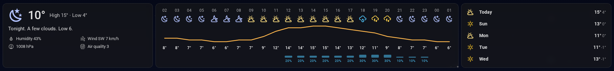

# Glass Weather Cards

Frosted-glass weather cards for Home Assistant dashboards: the conditions right now, the next
hours at a glance, and the week ahead. One colour per kind of weather, so a glance tells you
when it changes and to what.



- **`glass-weather-now`**: the temperature, today's high and low, a forecast summary, and
  details: feels like, humidity, wind and gusts, pressure (and whether it's rising or falling),
  UV, air quality, sunrise and sunset. Weather alerts appear on top when there are any, and
  there's a slot for your own outdoor sensor.
- **`glass-weather-hourly`**: an icon per hour, a temperature wave, the temperature and the
  chance of rain for the next 24 hours (or however many you choose). Scrolls sideways on
  narrow screens instead of squashing.
- **`glass-weather-week`**: the days ahead, one slim row each, with highs, lows and rain.
- **`glass-frost`**: wraps any other card in the same frosted glass, so a whole page matches.
  With `background: true` it pins the card behind the page instead (for an animated sky).
- **`glass-weather-calendar`** (dashboard strategy): a ready-made page with your calendars,
  the weather across the top and, optionally, a shopping list.

Forecasts come straight from your weather entity, the same way Home Assistant's own weather
cards get them, so any weather integration works. No helper sensors or templates needed.

## Install

With HACS (or the Home Assistant Marketplace from 2026.11): add this repository as a custom
repository of type **Dashboard**, then install **Glass Weather Cards**.

Manually: download `glass-weather-cards.js` from the latest release into `config/www/`, then
add `/local/glass-weather-cards.js` as a JavaScript module under
**Settings → Dashboards → ⋮ → Resources**.

Home Assistant 2026.6 or newer. Once installed, picking a weather entity in the card picker
suggests these cards, and each card has a visual editor.

## Cards

### glass-weather-now

```yaml
type: custom:glass-weather-now
entity: weather.home                    # required
summary_entity: sensor.forecast_text    # a sensor with a text forecast
yard_entity: sensor.yard_temperature    # your own outdoor sensor; set to null for an empty slot
feels_like_entities:                    # first one with a value wins
  - sensor.wind_chill
  - sensor.humidex
wind_gust_entity: sensor.wind_gust
pressure_tendency_entity: sensor.pressure_tendency   # "rising", "falling" or "steady"
uv_entity: sensor.uv_index
air_quality_entity: sensor.air_quality
alert_entities:                         # counts; alert titles are read from their attributes
  - sensor.weather_warnings
  - sensor.weather_watches
tap_action:
  action: navigate
  navigation_path: "#weather"
```

Everything but `entity` is optional. Without them the card still shows what the weather entity
itself provides (humidity, wind, pressure, feels like when the integration reports it).

### glass-weather-hourly

```yaml
type: custom:glass-weather-hourly
entity: weather.home
hours: 24        # 6–48
```

### glass-weather-week

```yaml
type: custom:glass-weather-week
entity: weather.home
days: 7          # as many as your weather integration forecasts
```

### glass-frost

```yaml
type: custom:glass-frost
card:
  type: todo-list
  entity: todo.shopping_list
```

The look is shared through two CSS variables you can set in a theme or with card-mod:
`--glass-weather-alpha` (default `0.55`) and `--glass-weather-blur` (default `8px`).

## The calendar dashboard

Create a dashboard, open its raw configuration editor, and use:

```yaml
strategy:
  type: custom:glass-weather-calendar
  weather_entity: weather.home
  calendars:
    - calendar.family
    - calendar.holidays
  shopping_list: todo.shopping_list     # optional
  now:                                  # optional settings passed to glass-weather-now
    summary_entity: sensor.forecast_text
  background: true                      # animated sky when Dynamic Weather Card is installed
```

It uses these other cards when they're installed, and falls back to Home Assistant's own cards
when they're not:

- [Daylight Calendar Card](https://github.com/superdingo101/daylight-calendar-card) for the
  calendar (otherwise the built-in calendar card)
- [Dynamic Weather Card](https://github.com/teuchezh/dynamic-weather-card) for the animated sky
  behind the page (otherwise no background)
- [Bubble Card](https://github.com/Clooos/Bubble-Card) for a weather pop-up with 48 hours and
  14 days (otherwise tapping the weather opens Home Assistant's own weather dialog)

## Credits

These cards stand on other people's work:

- **[Dynamic Weather Card](https://github.com/teuchezh/dynamic-weather-card)** by teuchezh
  (MIT): the animated sky behind the dashboard strategy, and the inspiration for pairing the
  weather with the page background.
- **[Weather Forecast Extended](https://github.com/Thyraz/weather-forecast-extended)** by Thyraz
  (MIT): its hourly strip, with an icon for every hour, is what `glass-weather-hourly` is
  modelled on.
- **[Daylight Calendar Card](https://github.com/superdingo101/daylight-calendar-card)** by
  superdingo101 (MIT): the calendar the dashboard strategy uses, with its own see-through settings.
- **[Bubble Card](https://github.com/Clooos/Bubble-Card)** by Clooos (MIT): the pop-up the
  dashboard strategy uses.
- **[Material Design Icons](https://pictogrammers.com/library/mdi/)** by Pictogrammers: every
  icon, through Home Assistant's built-in icon set.
- **[Home Assistant](https://www.home-assistant.io/)**: the weather forecast subscription,
  card picker and dashboard strategy APIs these cards are built on.

None of these projects are bundled here; the strategy only uses them when you've installed them.

## License

MIT. See [LICENSE](LICENSE).
